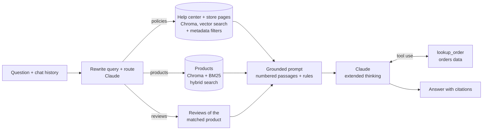

# ZNSouq Support Bot: a RAG Assistant for a Multi-Seller Marketplace

A customer- and seller-support chatbot for **ZNSouq**, a fictional Egyptian online marketplace where independent sellers run their own stores. It answers questions using **Retrieval-Augmented Generation (RAG)**: it searches the marketplace's help center, store pages, product catalog and customer reviews, then lets Claude write a grounded answer with citations. For order questions it calls a lookup **tool**.

> **Demo project:** ZNSouq, its stores, products, reviews, policies and contact details are all fictional and were generated for this project.

**Answer accuracy: 100% (45/45)** on a 45-question evaluation set graded by a stronger model, with a **100% retrieval hit rate** (see [Evaluation](#evaluation) for what this does and doesn't mean).

---

## What it can do

| Ask about | Example | How it's answered |
|---|---|---|
| Platform policies | "Can I return a shirt I already washed?" | Search over the help center |
| A specific store | "Falcon Deals says 7-day returns. Can I still return after 10 days?" | Store page + platform rules (platform minimums win) |
| Fees and dates | "What referral fee applies to an order placed on 31 Oct and shipped on 2 Nov?" | Date-aware answer from the fee docs |
| Products | "Who sells the Voltaro VO-528 Smart TV cheapest?" | Hybrid search over 5,000 products, comparing all offers and stock |
| Reviews | "What do customers say about the Zentro ZE-220 Smart Watch?" | Finds the product, then summarizes its reviews |
| Orders | "Where is my order ZN-98380209?" | `lookup_order` tool (own orders only) |
| Follow-ups | "...and for women's fashion?" | Conversation memory |
| Off-topic / unknown | "What's the capital of France?" | Politely declines; says "I don't know" instead of guessing |

It serves **buyers and sellers** (a toggle in the app), shows the **sources** behind every answer, and tells you what it searched for.

---

## How it works



1. **Indexing (once):** documents are split into sections (one chunk per `##` heading, each prefixed with "Title > Section"), embedded with `BAAI/bge-small-en-v1.5` (384 dimensions) and stored in **Chroma**: 845 help-center chunks plus 10,620 product and review chunks in a second collection.
2. **Query rewriting + routing:** Claude turns short or follow-up questions into a standalone search query and picks the sources to search (policies, products, reviews).
3. **Retrieval:**
   - **Policies:** vector search filtered by audience (buyer/seller). If a store is named, its store page is searched too.
   - **Products:** **hybrid search**, combining vector similarity with **BM25 keyword search** (for exact model codes like `VO-528`) via **Reciprocal Rank Fusion**.
   - **Reviews:** two-step lookup: find the product, then fetch its reviews by product ID.
   - The original question's results always stay; the rewritten query can only *add* chunks.
4. **Generation:** Claude answers **only from the numbered passages**, cites them like `[1]`, applies rules such as "platform rules beat store pages", "compare dates with today", "keep the conditions attached to fees", and says "I don't know" when the answer isn't there.
5. **Tools:** for order questions Claude calls `lookup_order`; the code enforces that customers can only see their own orders.

---

## Evaluation

`rag/evaluate.py` runs 45 test questions (facts, calculations, date-dependent rules, store overrides, conflicts, products, reviews, orders, unanswerable and off-topic questions, plus a regression test) and reports:

- **Retrieval hit rate:** did search find the right document or product?
- **Answer accuracy:** an LLM judge (a stronger model than the bot) compares each answer with the expected one, using the same passages the bot saw (it also checks faithfulness).

**Progress, from first version to final:**

| Version | Change | Accuracy |
|---|---|---|
| Baseline | Basic RAG pipeline | 83% (35 questions) |
| v2 | Query rewriting (original results kept first), extended thinking, clearer prompt rules, fairer test expectations | 94% (36 questions) |
| + Products & orders | Hybrid search, review lookup, order tool, 45 questions | 89% |
| Stronger judge | Sonnet as judge with full context; fixed a contradiction between two help-center pages | 93% (42/45) |
| **Final** | Prompt rules: keep the conditions attached to fees and deadlines; say when reviews disagree | **100% (45/45)** |

**What 100% means here:** the bot answered every question in *this* test set correctly, with every answer supported by its sources. It doesn't mean the bot is never wrong. The set is small, the bot was improved while looking at these questions, and LLM answers and judges vary slightly from run to run. The honest next step is testing on new, unseen questions.

**Lessons learned along the way**

- Change one thing at a time: a batch of "fixes" fixed 5 questions but broke 5 others.
- LLMs think by writing: forcing the answer first ("30 EGP… actually 45") caused errors; extended thinking fixed it.
- Not every failure is the bot's fault: several were wrong test expectations or judge mistakes. Always read the reasons.
- RAG surfaces contradictions in your own documents: the right fix was editing the document, not the prompt.
- Scores are only comparable with the same judge, given the same information.

---

## Project structure

```
├── app.py                  # Streamlit chat app
├── rag/
│   ├── loader.py           # parse markdown + metadata, chunk by heading
│   ├── index.py            # embed + store help-center chunks in Chroma
│   ├── retrieve.py         # vector search with metadata filters
│   ├── catalog.py          # products/reviews → text, hybrid search (BM25 + vectors)
│   ├── orders.py           # lookup_order tool (with privacy check)
│   ├── answer.py           # rewrite + route → retrieve → prompt → Claude (+ tools)
│   └── evaluate.py         # evaluation with an LLM judge
├── data/
│   ├── platform/           # buyer + seller help center (112 docs)
│   ├── sellers/            # 101 store pages
│   ├── catalog/            # products, reviews, sellers, sample orders
│   ├── eval/questions.jsonl
│   └── scripts/            # generators for the synthetic dataset
├── eval_results/           # saved evaluation runs
├── 01-05_*.ipynb           # learning notebooks (chunks, loader, index, retrieval, answers)
├── requirements.txt
└── .env.example
```

---

## Run it locally

**Requirements:** Python 3.11+ and an [Anthropic API key](https://console.anthropic.com).

```bash
git clone https://github.com/zeyad-fahmy/znsouq-rag.git
cd znsouq-rag

python -m venv .venv
# Windows (PowerShell):  .venv\Scripts\Activate.ps1
# macOS/Linux:           source .venv/bin/activate
pip install -r requirements.txt
```

Create a `.env` file (see `.env.example`):

```
ANTHROPIC_API_KEY=your-key-here
CLAUDE_MODEL=claude-haiku-4-5-20251001
JUDGE_MODEL=claude-sonnet-5
```

Build the two indexes (the first run downloads the embedding model):

```bash
python -m rag.index      # help center + store pages (~1 min)
python -m rag.catalog    # products + reviews (~5-15 min)
```

Start the app:

```bash
streamlit run app.py
```

Run the evaluation:

```bash
python -m rag.evaluate
```

---

## Tech stack

Python · [Claude API](https://docs.claude.com) (Haiku for answers, Sonnet as judge) · [Chroma](https://www.trychroma.com) · [sentence-transformers](https://www.sbert.net) (`bge-small-en-v1.5`) · [rank-bm25](https://github.com/dorianbrown/rank_bm25) · [Streamlit](https://streamlit.io)

## Limitations and next steps

- The dataset is synthetic; real support data is messier (typos, mixed Arabic/English, outdated pages).
- The evaluation set is small (45 questions), was used while improving the bot, and the LLM judge varies slightly between runs; new unseen questions are needed to confirm the score.
- Ideas: deploy publicly, add Arabic support, a reranking step, more adversarial test questions (prompt injection, false premises), and a custom web frontend.

---

Built by [Zeyad Fahmy](https://github.com/zeyad-fahmy) as a hands-on project to learn RAG from theory to implementation.
